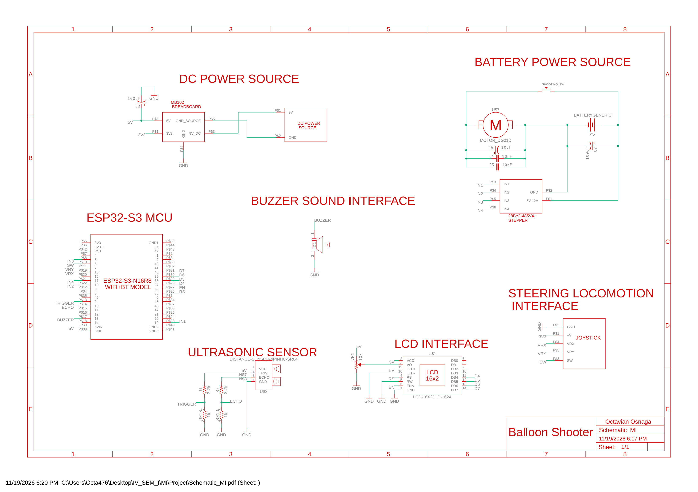

# Ballon Shooter Game

## Interface
The interface acts as an accessible game where the player can control the direction in which a fan points and blow obstacles (ballons) when desirable.

## Use cases
The interface was first design to incorporate a tank turret which could have been used to shoot at enemies, but now acts as an easy to play game, designed for regular users and even blind people as the interface incorporates an enemy sound alarm.

## Features
The interface was implemented with the following functionalities:
- Interactive menu used to calibrate the fan at a given position, set the speed of the revolution of the fan around the Oy axis and start the game;
- When the game starts, the fan can be moved using the joystick and the fan can be activated any time by pressing the green button;
- The Joystick can be pressed to exit the game and go back to the main menu (the joystick switch acts as an exit method for the menu also);
- When an enemy is in front of the ultrasonic sensor, a sound alarm is fired and based on the distance to the enemy the sound is stronger or weaker; this functionality was developed to help blind users to play the game (to give them a new set of eyes);
- When the user decides to close the game, the fan readjust to the calibrated initial position;
- During the game, the distance to the enemy and the angle of rotation is displayed on the display.

## Software
The software was developed in C++ using VSCode as the IDE with the PlatformIO extension. More details regarding the implementation are explained in the source code and dedicated README.md file.

## Hardware
The heart of the project was an **ESP32-S3-N16R8**, and the peripherals used were the ones provided in the development kit we received. We also 3D printed three components: the stepper mount, the ultrasonic sensor box and the DC motor lid. The wiring was done using Dupont wires and 2 solderless 830 points breadboards were used to connect some of the main components. A detailed electrical schematic which illustrates the whole system is placed in the repo’s root.

